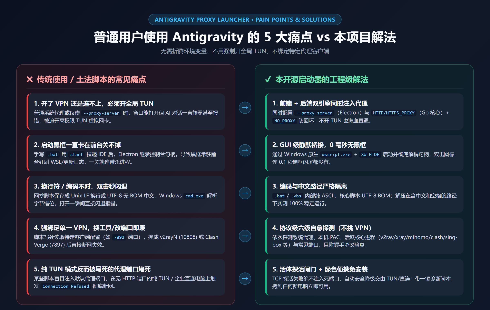
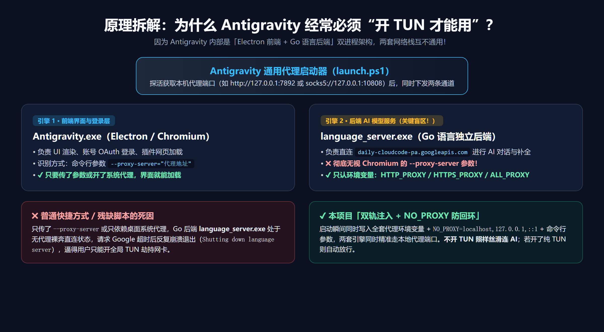
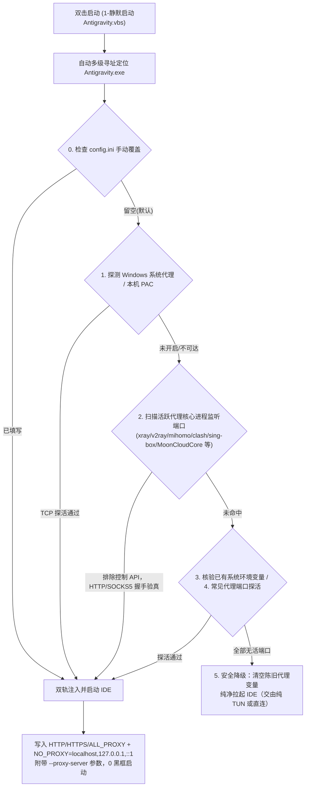
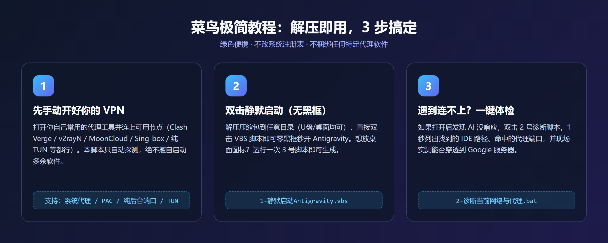
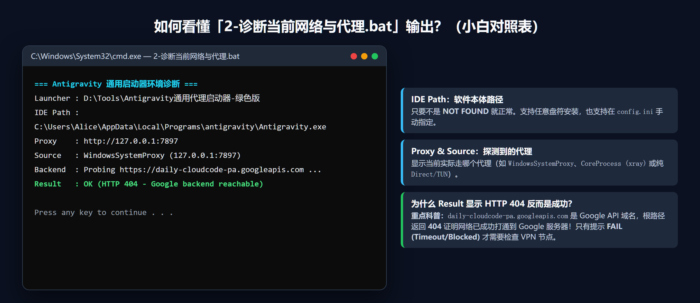

# Antigravity 通用代理启动器（Windows 绿色免安装版）

> **告别“必须开全局 TUN 才能用”、告别黑框常驻前台、告别换个 VPN 脚本就报废！**
> 专为 Windows 用户打造的 **跨 VPN 通用、零黑框静默、绿装便携** Antigravity IDE 启动器。


---

## 一、普通用户用 Antigravity 到底有哪些痛点？

很多 Windows 用户平时习惯使用 **Clash Verge、v2rayN、Mihomo Party、MoonCloud、Sing-box、Shadowsocks** 等本地代理工具，但一用 Antigravity IDE 就频频踩坑：



1. **只开系统代理经常失效，被迫开全局 TUN**：明明浏览器都能上 Google 了，Antigravity 窗口也能打开，但右侧 AI 对话一直转圈、提示连接超时，只有咬牙打开管理员权限的全局 TUN 虚拟网卡才能连上。
2. **网上抄来的 `.bat` 启动脚本黑框关不掉**：用批处理 `start` 拉起 IDE 后，CMD 黑框一直挂在桌面前台，满屏滚 `wsl:get-state failed`、`[AutoUpdater]` 日志，手滑关掉黑框还会把程序一起带崩。
3. **脚本换行符 / 中文编码一错就闪退**：复制粘贴保存成 Unix `LF` 换行或默认 UTF-8 含中文字符时，Windows `cmd.exe` 解析字节错位，双击黑框闪一下就没了，软件压根打不开。
4. **脚本强绑定某一款 VPN，换个工具立刻失效**：写死读取某款软件的私有配置文件或固定端口（如 `7892`），一旦换成 v2rayN（`10808/10809`）或 Clash Verge（`7897`），脚本直接废掉。
5. **到了纯 TUN 或直连电脑反而“帮倒忙”**：如果脚本盲目注入一个硬编码代理端口，而当前电脑根本没开那个端口（比如公司直连网或纯 TUN 模式），反而触发 `Connection Refused` 把正常网络彻底堵死。
6. **换台电脑就找不到软件路径**：把 `C:\Users\你的名字\...` 写死在脚本里，发给朋友或拷贝到公司电脑直接报错。

---

## 二、为什么必须开 TUN 才能用？（底层原理解密）



通过排查 Antigravity 进程与日志可以发现，它内部其实由 **两个完全独立的进程与网络栈** 协同工作：

1. **前端窗口层（`Antigravity.exe`，Electron / Chromium 内核）**：负责界面显示、OAuth 登录与网页插件，识别命令行参数 `--proxy-server`。
2. **后端 AI 模型核心（`language_server.exe`，Go 语言独立后台进程）**：负责真正连接 `daily-cloudcode-pa.googleapis.com` 与 `generativelanguage.googleapis.com` 完成对话与代码补全。**Go 语言后端完全不认 Chromium 的 `--proxy-server` 参数，只认操作系统的环境变量 `HTTP_PROXY` / `HTTPS_PROXY` / `ALL_PROXY`！**

这就是为什么你只加启动参数时“界面进去了，AI 全挂”，而一开 TUN（操作系统虚拟网卡在网络第 3 层强行接管所有流量）就突然好了。

### 本项目采用的「六级代理自愈探测 + 协议验真」机制

本启动器不绑死任何特定代理软件的配置格式，而是按 **Windows 系统与网络协议的客观物理事实** 自上而下探测，并内置 **TCP + 协议握手探活闸门**：



---

## 三、菜鸟保姆级使用教程（30 秒上手）



### 第一步：下载并解压

* **普通用户推荐**：直接在本仓库右侧 **[Releases](../../releases/latest)** 下载 `Antigravity-Proxy-Launcher-Portable.zip`（或点击页面右上角绿色 `Code -> Download ZIP` 解压后进入 `launcher` 文件夹）。解压后里面就是完整的中文操作目录 `Antigravity通用代理启动器-绿色版`。
* 解压到任意位置均可（桌面、`D:\Tools\`、U盘、甚至含中文和空格的路径都支持）。

> ⚠️ **Windows 安全提醒（必看）**：
> 如果是从浏览器/微信/QQ 接收的 `.zip` 压缩包，**解压前**建议右键压缩包 → **属性** → 勾选底部的 **“解除锁定 (Unblock)”** → 确定后再解压，可避免 Windows 弹出“已阻止脚本运行”的警告。

### 第二步：各文件是干嘛的？（一目了然）

| 文件名 | 菜鸟要不要点 | 用途说明 |
| :--- | :--- | :--- |
| **`1-静默启动Antigravity.vbs`** | **✅ 日常就点它** | 零黑框静默启动（连 0.1 秒闪屏都没有） |
| **`3-创建桌面快捷方式.bat`** | **⭐ 点一次即可** | 自动在桌面生成一个带 Antigravity 图标的 `Antigravity-RE` 快捷方式（生成后请勿删除原文件夹） |
| **`2-诊断当前网络与代理.bat`** | **🛠️ 连不上时点它** | 1 秒体检当前探测到的 IDE 路径、代理端口，并实测能否连通 Google 后端 |
| **`config.ini`** | 一般不用动 | 高级覆盖配置：可手动指定固定代理 `MANUAL_PROXY` 或自定义 `IDE_PATH` |
| **`core\launch.ps1`** | 别删 | 核心启动引擎，被上述入口调用 |

### 第三步：日常启动顺序

1. **先手动打开并连接你自己的 VPN**（如 Clash Verge、v2rayN、MoonCloud 等；不需要本工具帮你启动 VPN）。
2. 双击 **`1-静默启动Antigravity.vbs`**（或运行过 3 号脚本后，直接双击桌面新生成的 **`Antigravity-RE`** 图标）。
3. 稍等 1~2 秒，Antigravity 直接无黑框打开，AI 对话与代码补全正常连通！

---

## 四、连不上怎么办？如何看懂「一键诊断」结果

如果启动后感觉 AI 没响应，双击 **`2-诊断当前网络与代理.bat`**，你会看到类似下面的终端报告：



### 小白快速排查对照

* **`IDE Path` 显示 `NOT FOUND`**：说明 Antigravity 装在了非常偏僻的目录且没有注册表/快捷方式记录。用记事本打开 `config.ini`，在 `IDE_PATH=` 后面填上 `Antigravity.exe` 的完整路径即可。
* **`Result` 显示 `OK (HTTP 404 - Google backend reachable)`**：
  > 💡 **千万别被 `404` 吓到！** `daily-cloudcode-pa.googleapis.com` 是 Google API 服务器域名，根目录没有网页所以返回 `404`，**这恰恰证明你的网络已经 100% 成功穿透到了 Google 服务器！**
* **`Result` 显示 `FAIL (Timeout/Blocked)`**：说明本地端口虽然连上了，但你的 VPN 节点本身不通或超时了，请去 VPN 软件里换一个延迟正常的节点再测。

---

## 五、常见 VPN 工具兼容与配合建议

| 你使用的代理方式 | 是否需要开 TUN | 本启动器表现 |
| :--- | :--- | :--- |
| **Clash Verge / Mihomo Party / FlClash / MoonCloud**（开系统代理） | ❌ 不需要 | 自动读取系统代理并 TCP 验真，秒开畅通 |
| **v2rayN / Clash / Sing-box**（不开系统代理，仅后台开端口） | ❌ 不需要 | 自动识别活跃核心进程（`xray`/`mihomo`/`sing-box` 等）监听端口 |
| **PAC 自动配置模式**（`http://127.0.0.1:.../pac`） | ❌ 不需要 | 500ms 快速拉取本地 PAC 规则并提取真实端口 |
| **纯 TUN 模式 / LetsVPN / WireGuard / 企业内网直连** | ✅/直连 | 探测不到本地代理端口时自动清空旧环境变量，纯净启动不堵路 |
| **同时运行多个冷门代理工具且均未开系统代理** | 可选 | 建议在 `config.ini` 填写 `MANUAL_PROXY=http://127.0.0.1:你的端口` |

---

## 六、高级自定义（`config.ini`）

绝大多数情况下 **`config.ini` 全程留空即可**。仅在特殊环境用记事本修改：

```ini
# 1. 手动固定代理（仅当自动识别不符合预期、或希望 IDE 单独走某端口时填写）
MANUAL_PROXY=http://127.0.0.1:10809

# 2. 手动指定 Antigravity.exe 路径（仅当软件装在极其冷门的自定义路径时填写）
IDE_PATH=D:\MyApps\Antigravity\Antigravity.exe
```

---

## 七、菜鸟常见排错 FAQ

<details>
<summary><b>Q1：我先开了 Antigravity，后来才开 VPN，再点脚本为什么还是连不上？</b></summary>

这是 Electron 软件的**单实例保护机制**导致的：只要后台还有之前直连打开的 Antigravity 进程活着，再点启动器只会把旧窗口唤到前台，**无法给已经运行的旧进程热更新代理环境变量**。
**解决办法**：先彻底退出全部 Antigravity 窗口（必要时在任务管理器确认无 `Antigravity.exe` 残留），再双击本启动器打开。
</details>

<details>
<summary><b>Q2：双击 <code>1-静默启动Antigravity.vbs</code> 弹出“Windows Script Host 访问已被禁用”或用记事本打开了？</b></summary>

* **用记事本/编辑器打开了**：说明你电脑把 `.vbs` 文件关联改成了文本编辑器。运行一次 `3-创建桌面快捷方式.bat`，它会强制用系统的 `wscript.exe` 来跑，绕过文件关联问题。
* **提示“Windows Script Host 已禁用”**：部分高度管控的企业域控电脑在组策略里禁用了 `.vbs`。此时可右键新建一个 `.bat` 文件写入 `powershell -NoProfile -ExecutionPolicy Bypass -WindowStyle Hidden -File "%~dp0core\launch.ps1"` 作为备用启动入口。
</details>

<details>
<summary><b>Q3：这个工具安全吗？会读取我的账号或修改系统设置吗？</b></summary>

**100% 纯本地透明脚本，所有代码均为纯文本可直接在记事本/VS Code 查看**：
* 不修改系统全局环境变量，不修改系统代理注册表，仅在启动 Antigravity 的子进程空间临时注入代理；
* 正常启动过程零外网请求、零遥测上报；
* 仅在你手动运行 `2-诊断当前网络与代理.bat` 时，用系统自带 `curl.exe` 向 `https://daily-cloudcode-pa.googleapis.com/` 发一次 4 秒超时的连通性检查。
</details>

<details>
<summary><b>Q4：当前还不支持哪些极端场景？</b></summary>

1. 仅支持 **Windows 10 / Windows 11**（需自带 PowerShell 5.1+）；
2. 暂未内置需**账号密码弹窗鉴权**的企业 HTTP 代理（`http://user:pass@ip:port` 可尝试写入 `config.ini` 的 `MANUAL_PROXY`）；
3. 暂不解析远程公网地址的 PAC（`http://公司内网域名/proxy.pac`）。
</details>

---

## 八、开发者说明：目录结构、测试与打包

```text
antigravity-proxy-launcher/
├── README.md                              # 本文档
├── LICENSE                                # MIT 开源协议
├── assets/                                # 文档图解资源
├── launcher/                              # 绿色便携核心包（唯一真相源）
│   ├── 1-静默启动Antigravity.vbs
│   ├── 2-诊断当前网络与代理.bat
│   ├── 3-创建桌面快捷方式.bat
│   ├── config.ini
│   ├── 使用说明.txt
│   └── core/launch.ps1
├── scripts/
│   └── build-release.ps1                  # 打包生成 dist/Antigravity通用代理启动器-绿色版.zip
└── tests/
    └── test-launcher.ps1                  # 回归测试（解析边界、Mock HTTP/SOCKS5/PAC/IPv6、中文路径解压）
```

在项目根目录运行自动化测试与打包发布：

```powershell
# 运行全套回归测试（含打包与中文空格路径解压验真）
powershell -NoProfile -ExecutionPolicy Bypass -File .\tests\test-launcher.ps1

# 单独构建绿色发布压缩包（输出到 dist\）
powershell -NoProfile -ExecutionPolicy Bypass -File .\scripts\build-release.ps1
```

---

如果这个小工具帮到了你，欢迎点个 **Star** 分享给同样被 Antigravity 代理问题折磨的朋友！
